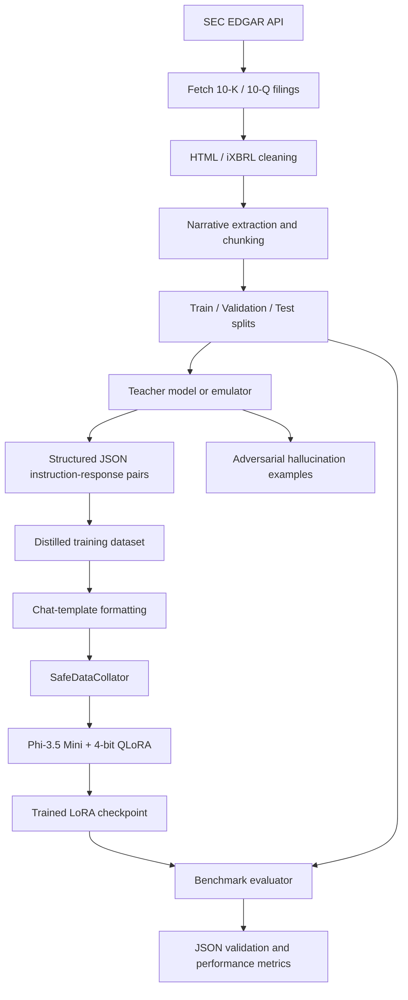

Opti-LLM
Domain-Specific Financial LLM Distillation & Optimization Pipeline
Opti-LLM is an end-to-end pipeline designed to distill
financial-document analysis capabilities into a lightweight
3.8B-parameter student model based on
microsoft/Phi-3.5-mini-instruct.

The project targets institutional analysis of SEC 10-K and 10-Q
filings. It combines SEC filing acquisition and preprocessing,
teacher-generated training data, adversarial examples, 4-bit QLoRA
fine-tuning, and evaluation of structured JSON output and inference
performance.
Reported project targets/results: approximately 10× lower latency
and 90% lower VRAM consumption compared with a larger-model
deployment. These figures should be treated as project-reported claims
until the benchmark report specifies the comparison model, hardware,
workload, and measurement method.

Table of Contents
- 1. Problem
- 2. Solution Overview
- 3. Architecture
- 4. Pipeline Phases
- 5. Model and Training
  Configuration
- 6. Engineering Safeguards
- 7. Repository Structure
- 8. Requirements
- 9. Installation
- 10. Run the Pipeline
- 11. Inference Example
- 12. Evaluation
- 13. Current Reported Training
  Telemetry
- 14. Limitations and Validation
  Notes
1. Problem
Using large language models for high-volume financial filing analysis
can introduce three practical challenges:
1. Inference cost and latency: Large models can require substantial
   GPU memory and compute, making bulk document processing expensive.
2. Unreliable output formatting: General-purpose models may return
   explanations or Markdown around JSON, disrupting automated
   downstream systems.
3. Financial hallucinations: Invented or incorrectly attributed
   financial figures can undermine the reliability of financial
   analysis.
Opti-LLM addresses these challenges by specializing a smaller model for
selected financial-document tasks and evaluating its output structure
and inference performance.
2. Solution Overview
The pipeline has four main stages:
1. SEC data acquisition: Collect and preprocess 10-K and 10-Q
   filings.
2. Teacher distillation: Generate structured instruction-response
   examples for financial analysis, including adversarial examples.
3. Student fine-tuning: Fine-tune Phi-3.5 Mini using 4-bit
   quantization and LoRA adapters.
4. Evaluation: Measure JSON validity, inference latency, and
   generation throughput on an unseen test split.
Supported task types
  Task                                Purpose
  summarize                         Produce an executive summary of
financial and operational updates.

  extract_risk                      Identify material vulnerabilities
and regulatory threats.

  analyze_controls                  Extract information about internal
accounting controls and
quantitative metrics.
generate_hallucination            Generate controlled, plausible
false statistics for adversarial
robustness experiments.
3. Architecture

4. Pipeline Phases
Phase 1 --- SEC EDGAR data acquisition and preprocessing
Main file: src/opti_llm/data_pipeline/sec_pipeline.py

The data pipeline collects SEC filings for the following 20 companies:

AAPL, MSFT, GOOGL, AMZN, META, TSLA, NVDA, JPM, V,
WMT, BAC, MA, HD, PG, JNJ, UNH, XOM, INTC, CSCO,
NFLX.

The pipeline:
- Fetches 10-K and 10-Q filings from SEC EDGAR.
- Uses a thread-safe rate limiter, configured for a maximum of 8
  requests per second.
- Implements exponential backoff for HTTP 429 responses.
- Cleans HTML and iXBRL content using BeautifulSoup and lxml.
- Removes hidden iXBRL elements, scripts, styles, and dense numeric
  tables according to the configured filtering rule.
- Preserves narrative sections including Item 1 (Business), Item 1A
  (Risk Factors), Item 7 (Management's Discussion and Analysis), and
  Item 9 (Controls).
- Splits narrative text into 512-word chunks with a 64-word overlap.
- Creates an 80/10/10 train, validation, and test split.
Output locations:
- data/raw/ --- downloaded filing files.
- data/processed/ --- processed data.
- data/splits/ --- train, validation, and test datasets.
- data/dataset_stats.json --- ticker and SEC-section distribution
  statistics.
Phase 2 --- Knowledge distillation and adversarial data generation
Main files:
- src/opti_llm/training/distillation.py
- src/opti_llm/training/distillation_engine.py
A teacher model or emulator processes filing chunks and generates
structured responses for the supported tasks.

The adversarial data process introduces controlled errors, such as:
- Changing the magnitude of a financial statistic.
- Reversing the meaning of a financial entity, such as profit and
  loss.
Malformed teacher outputs are filtered or quarantined. The project
documentation reports 10,951 clean instruction-response pairs after
filtering.

The generated training records are stored in:

data/processed/distilled_train.jsonl

Important: Adversarial examples are described as a training and
evaluation mechanism. Their presence alone does not establish that the
student can reliably detect every hallucination. That capability must be
demonstrated with a clearly defined held-out evaluation.
Phase 3 --- 4-bit QLoRA fine-tuning
Main file: src/opti_llm/training/train.py

The student model is:

microsoft/Phi-3.5-mini-instruct

The documented configuration is:

  Setting                   Value
  Base model                microsoft/Phi-3.5-mini-instruct
Model parameters          Approximately 3.84B
Quantization              4-bit NF4
Double quantization       Enabled
Compute dtype             bfloat16
LoRA rank                 16
LoRA alpha                32
LoRA dropout              0.05
Target modules            qkv_proj, o_proj, gate_up_proj, down_proj
Trainable parameters      25,165,824
Percentage trainable      Approximately 0.6543%
Per-device batch size     4
Gradient accumulation     4
Effective batch size      16
Optimizer                 paged_adamw_32bit
Learning rate             2e-4
Learning-rate schedule    Cosine
Maximum sequence length   2048 tokens

Only the LoRA parameters are trained; the base model is quantized to
reduce memory requirements.

The training script also supports checkpoint saving and resuming. The
documented configuration saves checkpoints every 200 steps and retains
up to two checkpoints.
Phase 4 --- Benchmarking and evaluation
Main file: src/opti_llm/evaluation/evaluate_benchmark.py

The evaluator loads the trained adapter, runs inference against unseen
test samples, and measures:
- Strict JSON parse rate: whether generated output can be parsed
  using json.loads().
- Inference latency: time taken to generate a response.
- Throughput: generated tokens per second.
The documented output is:

evaluation_report.json

For meaningful comparisons, benchmark results should include the model
configuration, hardware, test-set size, prompt and generation settings,
warm-up policy, and measurement procedure.
5. Model and Training Configuration
Student model
The student is Phi-3.5 Mini Instruct, with approximately 3.84 billion
parameters. The project uses 4-bit NF4 quantization and LoRA adapters to
reduce the amount of memory and trainable parameters required.
Trainable parameter ratio
The project reports:
- Total parameters: 3,846,245,376
- Trainable parameters: 25,165,824
- Trainable proportion: approximately 0.6543%
This means the fine-tuning process updates a small subset of parameters
through LoRA adapters rather than updating the full base model.
6. Engineering Safeguards
The project documentation describes the following engineering fixes.
6.1 SafeDataCollator
Problem: Invalid or out-of-range token IDs and incorrectly handled
padding can cause failures in the GPU loss calculation.

Documented approach: The custom SafeDataCollator clamps input
token IDs to the configured vocabulary range and masks padding and
invalid target positions with -100 before loss calculation.

Validation note: Clamping token IDs prevents out-of-range indices
but does not make an invalid token semantically correct. Invalid-token
handling should be tested explicitly, and corrupted examples should be
investigated rather than silently converted into valid-looking tokens.
6.2 Shared-cluster GPU configuration
The documented workaround isolates GPU 0 and disables selected NCCL
probes:
CUDA_VISIBLE_DEVICES=0
NCCL_NVML_DISABLE=1
NCCL_P2P_DISABLE=1
These settings were used to work around reported NVML and multi-GPU
communication conflicts in the development environment. They are
environment-specific workarounds, not universal production defaults.
6.3 Automatic checkpoint resumption
The training script uses
transformers.trainer_utils.get_last_checkpoint to locate the latest
checkpoint and resume interrupted training.

The documented save interval is 200 steps, with save_total_limit=2.
6.4 Phi-3.5 DynamicCache compatibility
The benchmark generation configuration uses:
use_cache=False
This was documented as a workaround for a DynamicCache.seen_tokens
compatibility issue in the project's Transformers environment. Disabling
the cache can affect generation speed, so benchmark comparisons should
use consistent settings.
7. Repository Structure
opti_llm/
│
├── data/
│   ├── raw/                          # Downloaded SEC 10-K / 10-Q files
│   ├── processed/                    # Cleaned and distilled records
│   ├── distillation/                 # Teacher outputs and adversarial data
│   ├── splits/
│   │   ├── train.jsonl
│   │   ├── validation.jsonl
│   │   └── test.jsonl
│   └── dataset_stats.json
│
├── models/
│   └── opti_student_model/
│       ├── checkpoint-1400/
│       └── ...                       # Other retained model artifacts
│
├── src/
│   └── opti_llm/
│       ├── data_pipeline/
│       │   └── sec_pipeline.py
│       │
│       ├── training/
│       │   ├── distillation_engine.py
│       │   ├── distillation.py
│       │   └── train.py
│       │
│       └── evaluation/
│           └── evaluate_benchmark.py
│
├── evaluation_report.json
└── README.md
8. Requirements
The documented stack includes:
- Python 3
- PyTorch
- Transformers
- Hugging Face Datasets
- PEFT
- bitsandbytes
- Accelerate
- BeautifulSoup 4
- lxml
- Requests
A compatible NVIDIA GPU and CUDA environment are recommended for the
documented 4-bit QLoRA training setup. Exact compatibility depends on
the operating system, GPU, CUDA runtime, PyTorch build, and bitsandbytes
version.
9. Installation
9.1 Clone the repository
git clone <YOUR_REPOSITORY_URL>
cd opti_llm
Replace <YOUR_REPOSITORY_URL> with the actual repository URL.
9.2 Create a virtual environment
Linux:
python3 -m venv opti_venv
source opti_venv/bin/activate
Windows PowerShell:
python -m venv opti_venv
.\opti_venv\Scripts\Activate.ps1
9.3 Install dependencies
Install a PyTorch build compatible with your machine and CUDA
environment. The original project setup documents:
pip install torch torchvision torchaudio --index-url https://download.pytorch.org/whl/cu121
Then install the project dependencies:
pip install transformers datasets peft bitsandbytes accelerate beautifulsoup4 lxml requests
Environment note: The CUDA 12.1 command is the documented setup, not
a guarantee that it will work on every machine. Check your installed
NVIDIA driver, CUDA compatibility, Python version, and package support
before selecting a PyTorch build.
10. Run the Pipeline
Run the four stages from the repository root, with the virtual
environment activated.
Step 1 --- Download and preprocess SEC filings
python src/opti_llm/data_pipeline/sec_pipeline.py
Expected result: downloaded filings, cleaned narrative text, chunks, and
dataset splits.
Step 2 --- Generate distilled training data
python src/opti_llm/training/distillation_engine.py
The repository also contains distillation.py for the LLM teacher
batch-generation engine.

Expected result: structured instruction-response records and adversarial
data according to the configured pipeline.
Step 3 --- Fine-tune the student model
python src/opti_llm/training/train.py
The training script is documented to resume from the latest available
checkpoint when one exists.
Step 4 --- Evaluate the trained model
python src/opti_llm/evaluation/evaluate_benchmark.py
Expected result: benchmark metrics and evaluation_report.json.
Run these commands only after checking the scripts' configuration,
required credentials (if any), data paths, and hardware assumptions.
The README does not assume that external teacher-model access is
configured automatically.

11. Inference Example
The following example shows the documented adapter-loading and
generation pattern. It assumes that the base model and adapter
checkpoint have already been downloaded or saved at the specified
locations.
import torch
from transformers import (
    AutoModelForCausalLM,
    AutoTokenizer,
    BitsAndBytesConfig,
)
from peft import PeftModel

base_model_id = "microsoft/Phi-3.5-mini-instruct"
adapter_dir = "models/opti_student_model/checkpoint-1400"

tokenizer = AutoTokenizer.from_pretrained(
    adapter_dir,
    trust_remote_code=True,
)

bnb_config = BitsAndBytesConfig(
    load_in_4bit=True,
    bnb_4bit_compute_dtype=torch.bfloat16,
)

base_model = AutoModelForCausalLM.from_pretrained(
    base_model_id,
    quantization_config=bnb_config,
    device_map="auto",
    trust_remote_code=True,
)

model = PeftModel.from_pretrained(
    base_model,
    adapter_dir,
).eval()

messages = [
    {
        "role": "system",
        "content": (
            "You are an expert AI financial analyst. "
            "Respond only with valid raw JSON."
        ),
    },
    {
        "role": "user",
        "content": (
            "COMPANY: AAPL\n"
            "TEXT:\n"
            "Gross margin increased to 46.2% driven by Services growth, "
            "though foreign exchange headwinds negatively impacted revenue "
            "by 200 basis points.\n\n"
            "INSTRUCTION:\n"
            "Extract specific risks."
        ),
    },
]

prompt = tokenizer.apply_chat_template(
    messages,
    tokenize=False,
    add_generation_prompt=True,
)

inputs = tokenizer(
    prompt,
    return_tensors="pt",
).to(model.device)

with torch.no_grad():
    outputs = model.generate(
        **inputs,
        max_new_tokens=256,
        do_sample=False,
        use_cache=False,
    )

generated_tokens = outputs[0][inputs.input_ids.shape[1]:]
response = tokenizer.decode(
    generated_tokens,
    skip_special_tokens=True,
)

print(response)
The system prompt requests raw JSON, but prompting alone does not
guarantee valid JSON. Validate the output before using it in a
downstream application:
import json

try:
    result = json.loads(response)
    print("Valid JSON")
except json.JSONDecodeError as error:
    print(f"Invalid JSON: {error}")
12. Evaluation
The project documents three principal benchmark dimensions.
  Metric                              What it measures
  Strict JSON parse rate              Percentage of model responses
successfully parsed as JSON.

  Average inference latency           Average time taken to generate a
response.
Tokens per second                   Generation throughput.
For a reliable evaluation:
1. Use a held-out test set that was not used to generate training
   examples or tune the model.
2. Report the number of evaluated examples and the task distribution.
3. Use the same hardware and comparable generation settings for
   baseline and student models.
4. Include warm-up runs and clearly define how latency is measured.
5. Report JSON validity separately from factual correctness.
6. Evaluate financial figures against source evidence, not only against
   output formatting.
7. Evaluate adversarial detection on a separately defined test set.
The expected report path is:
evaluation_report.json
13. Current Reported Training Telemetry
The supplied project documentation reports the following training-loss
milestones:

  Milestone             Global step   Training loss
  Initialization                 10         11.7639
Warmup complete               100          6.9957
Checkpoint 1                  200          6.1458
Checkpoint 2                  400          4.7221
Checkpoint 3                  600          3.5926
Production anchor            1400          ~3.40

These are the training telemetry values reported in the project notes.
Training loss alone does not establish financial accuracy, hallucination
resistance, generalization, or production readiness.
14. Limitations and Validation Notes
Before presenting Opti-LLM as a production-ready financial analysis
system, validate the following:
- Benchmark evidence: The supplied project notes describe
  approximately 10× lower latency and 90% lower VRAM consumption, but
  do not provide the complete baseline configuration or raw
  measurements in the supplied text.
- Financial accuracy: A valid JSON response can still contain
  incorrect figures, incorrect company attribution, or unsupported
  conclusions.
- Hallucination resistance: Controlled hallucination examples are
  part of the documented data strategy; measured detection performance
  is not included in the supplied project notes.
- Data quality and leakage: Verify filing dates, duplicate chunks,
  company overlap, and train/test separation. Ensure the test set is
  not indirectly used during teacher-data generation or prompt
  development.
- SEC data handling: Follow SEC access policies and provide an
  appropriate identifying User-Agent in the actual crawler
  configuration.
- Collator behavior: Clamping invalid token IDs should not replace
  investigation and filtering of malformed data.
- Hardware portability: Quantization, bfloat16, bitsandbytes,
  and CUDA behavior vary by hardware and software versions.
- Model limitations: The system should support analyst workflows,
  not replace professional financial, legal, or investment review.
Project Summary
Opti-LLM explores a practical approach to specialized financial language
models:

SEC filings → preprocessing → teacher distillation → adversarial
examples → 4-bit QLoRA fine-tuning → structured inference →
benchmarking.

Its central engineering objective is to make selected financial-document
analysis tasks more efficient while maintaining structured outputs. Its
actual accuracy, robustness, and efficiency should be established
through reproducible evaluation.
